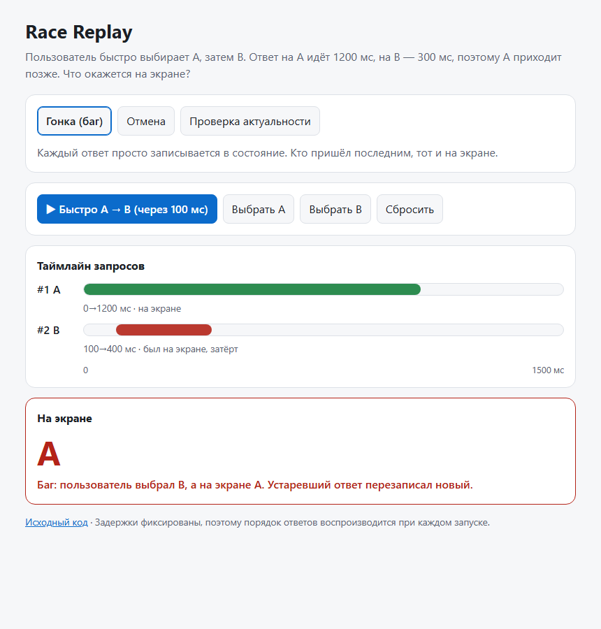

# Race Replay

[](https://github.com/Oleg4311/race-replay/actions/workflows/ci.yml)

Интерактивный разбор гонки запросов в React: пользователь быстро выбирает A, затем B, а медленный ответ на A приходит позже ответа на B и перезаписывает его. Демо показывает один и тот же сценарий в трёх режимах и рисует таймлайн: когда запрос начался, когда завершился и какой результат попал на экран.

**Демо:** https://oleg4311.github.io/race-replay/



## Режимы

| Режим | Что происходит | Что на экране |
|---|---|---|
| Гонка (баг) | Каждый ответ пишется в состояние как есть | **A**: устаревший ответ затёр новый |
| Отмена | Новый выбор отменяет предыдущий запрос через `AbortController` | **B** |
| Проверка актуальности | Запросы не отменяются, но принимается только ответ последнего выбора | **B** |

Задержки фиксированы: A отвечает за 1200 мс, B за 300 мс, второй клик идёт через 100 мс после первого. Поэтому порядок событий одинаков при каждом запуске: B отвечает на 400-й мс, A на 1200-й.

## Быстрый старт

```
npm install
npm run dev          # http://localhost:5173/race-replay/
npm test             # юнит-тесты движка (vitest)
npm run e2e          # сценарии в браузере (Playwright, Chromium)
```

Один раз для e2e: `npx playwright install chromium`.

## Чем отличается

- В документации React и в статьях про `useEffect` гонка описана текстом и коротким кодом. Здесь её можно **запустить и увидеть** на таймлайне, переключая стратегии на одном и том же сценарии.
- Playwright умеет управлять временем (`page.clock`), но готового стенда с гонкой и исправлениями нет. Тесты проекта показывают приём: часы браузера подменены, порядок ответов задан, проверка не зависит от случайных миллисекунд.
- Движок ([src/engine.ts](src/engine.ts)) не зависит от React, поэтому его можно читать и тестировать отдельно, а интерфейс только отображает состояние.

## Как это работает

- `fakeFetch(item, ms, signal)` имитирует сервер: отвечает через заданное время или отклоняется с `AbortError`.
- `createEngine(mode, now, onChange)` ведёт журнал запросов и применяет выбранную стратегию к каждому ответу. Исход запроса: `shown`, `replaced`, `ignored`, `aborted` или `pending`.
- Таймлайн рисуется по журналу, а проверка «верно или баг» сравнивает то, что на экране, с последним выбором пользователя.

## Тесты

- **Юнит (vitest):** три режима, порядок ответов, отмена уже завершённого запроса, `dispose`.
- **e2e (Playwright):** в исходном режиме на экране A, в двух исправленных остаётся B; детерминированные времена на таймлайне; сброс и смена режима не пропускают ответы старого движка.
- После публикации GitHub Actions повторяет те же e2e-сценарии на живом адресе.

## Публикация

Сборка и деплой идут через GitHub Actions: `ci.yml` проверяет типы, тесты и сборку, `pages.yml` публикует `dist` на GitHub Pages и затем прогоняет e2e против опубликованного URL.

## Лицензия

MIT · Сделано с помощью Claude

## English

**Race Replay** is an interactive replay of a classic React data-fetching race: the user picks A, then B, but the slow response to A arrives after the response to B and overwrites it. The demo shows the same scenario in three modes (naive, `AbortController` cancellation, staleness guard) with a timeline of when each request started, finished and what ended up on screen. Delays are fixed and the e2e tests control the browser clock (`page.clock`), so the order of responses is deterministic. Live demo: https://oleg4311.github.io/race-replay/
